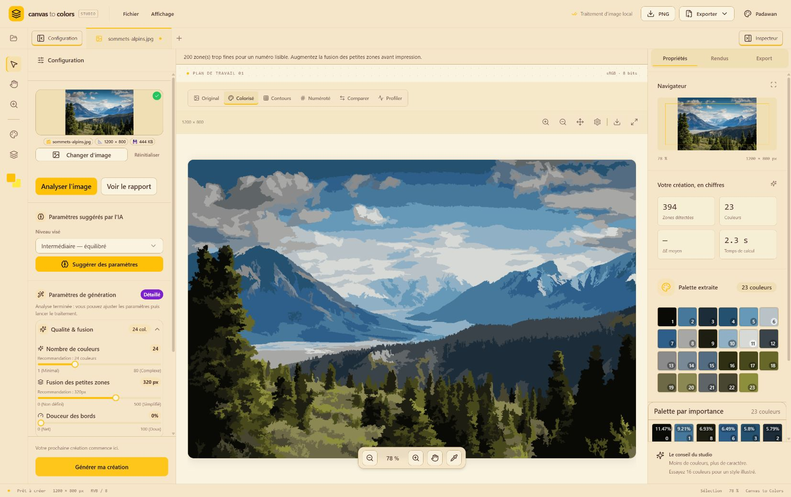

# Canvas to Colors

### De la photo au modèle de peinture par numéros.

**Canvas to Colors — PaintByNumbers Studio** transforme vos images en une palette de peinture, des contours et un dessin numéroté. Importez une photo, analysez ses couleurs, ajustez le niveau de détail et préparez vos rendus à télécharger ou à imprimer, dans un même atelier visuel.



*Capture de l’application locale. [Photo source sur Unsplash](https://images.unsplash.com/photo-1464822759023-fed622ff2c3b).*

[Présentation](#présentation) · [Installation](#installation) · [Utilisation](#utilisation) · [Développement](#développement)

## Présentation

Le studio associe un plan de travail central, un panneau de configuration et un inspecteur. Parcourez l’original, le rendu colorisé, les contours, les zones numérotées et une comparaison avant/après.

- **Importer** une image PNG, JPEG, WebP ou SVG, par fichier ou glisser-déposer. L’import par URL et la capture webcam sont également disponibles.
- **Analyser** les couleurs, les contours et la complexité pour obtenir des recommandations de départ.
- **Ajuster** le nombre de couleurs, la fusion des petites zones, la douceur des bords, la palette et les effets artistiques.
- **Inspecter** le modèle avec le zoom, le déplacement, la palette extraite et les différents rendus.
- **Exporter** un PNG, un ZIP réunissant les rendus ou un PDF avec modèle et légende. L’inspecteur propose aussi des options de calques, de résolution et de mise en page.
- **Enregistrer** un projet dans le navigateur et le rouvrir depuis le menu Fichier.
- **Personnaliser** l’atelier avec les quinze palettes issues de CryptoKeep, dont Padawan, Sith et Millennium, ainsi que les modes clair, sombre et système.

L’analyse et la génération s’exécutent dans le navigateur, avec des Web Workers pour les calculs. Les grandes images sont adaptées à une résolution de travail maximale de **1 200 pixels sur le plus grand côté** ; les fichiers sont limités à **20 Mo**. Augmenter la résolution d’export ne recrée pas les détails supprimés lors de cette adaptation.

Le projet est en cours d’affinage. Un dessin très détaillé peut encore produire des zones trop fines pour recevoir un numéro lisible : le studio signale ces cas pour permettre une vérification avant impression.

## Installation

### Prérequis

- **Node.js 22.12 ou plus récent dans la branche 22**, ou **Node.js 24 et plus**.
- **npm**, utilisé avec le fichier `package-lock.json` du dépôt.
- Un navigateur récent prenant en charge Canvas et les Web Workers.

### Installer et démarrer

```bash
git clone https://github.com/Giscolab/paint-by-numbers-generator.git
cd paint-by-numbers-generator
npm ci
```

Le client Supabase attend les deux variables suivantes dans un fichier `.env` à la racine. Si le dépôt local possède déjà ce fichier, conservez sa configuration.

```dotenv
VITE_SUPABASE_URL=https://votre-projet.supabase.co
VITE_SUPABASE_PUBLISHABLE_KEY=votre-cle-publique-supabase
```

Utilisez l’URL et la clé publique de votre projet Supabase. Les valeurs préfixées par `VITE_` sont exposées au navigateur : n’y placez aucune clé secrète ou `service_role`.

```bash
npm run dev
```

Ouvrez **[http://localhost:8080/](http://localhost:8080/)**. Si ce port est déjà occupé, consultez l’adresse indiquée par Vite dans le terminal.

### Services optionnels

Le calcul des modèles reste local. Deux fonctions Supabase complètent l’expérience : `fetch-image-url` sert de relais lorsque l’image distante ne peut pas être téléchargée directement, et `suggest-parameters` fournit les suggestions d’IA distante. Leur code se trouve dans [`supabase/functions/`](supabase/functions/).

Le bouton **Suggérer des paramètres** transmet un résumé numérique de l’analyse, sans les pixels de l’image. Une suggestion locale est proposée si le service distant échoue. L’import par URL nécessite un accès réseau ; la webcam nécessite votre autorisation dans le navigateur.

## Utilisation

### Créer un premier modèle

1. **Importez votre image** avec le bouton d’ouverture ou la zone de dépôt du panneau Configuration. Choisissez de préférence un sujet bien détaché de son arrière-plan.
2. Cliquez sur **Analyser l’image**. Le rapport présente les mesures et des recommandations sur la palette et la taille des zones.
3. Cliquez sur **Appliquer les recommandations**, puis ajustez les paramètres si nécessaire. Vous pouvez aussi demander des suggestions adaptées au niveau débutant, intermédiaire ou expert.
4. Cliquez sur **Générer ma création** et suivez la progression du traitement.
5. Parcourez les vues **Colorisé**, **Contours**, **Numéroté** et **Comparer**. Zoomez pour contrôler les détails et la lisibilité des numéros.
6. Téléchargez votre résultat avec **PNG**, le menu **Exporter** ou l’onglet **Export** de l’inspecteur.

### Choisir le bon niveau de détail

| Paramètre | Effet recherché |
| --- | --- |
| Nombre de couleurs | Une palette réduite simplifie la peinture ; une palette plus large conserve davantage de nuances. |
| Fusion des petites zones | Une valeur plus élevée regroupe davantage de petites régions et facilite le coloriage. |
| Douceur des bords | Ajuste le lissage du modèle. Vérifiez le résultat dans les vues Contours et Numéroté. |
| Palette et effets | Modifient l’apparence du rendu. Contrôlez le modèle après chaque modification. |

Si un avertissement indique des zones trop fines, augmentez la fusion des petites zones ou réduisez le nombre de couleurs, puis relancez la génération. Les recommandations constituent un point de départ ; la vérification visuelle reste nécessaire avant impression.

### Se déplacer dans le studio

Les commandes **Configuration** et **Inspecteur**, en haut de l’espace de travail, permettent de replier et déplier les panneaux. Utilisez les outils de zoom, de déplacement et d’ajustement à l’écran pour examiner votre création. Sur un écran étroit, repliez un panneau pour dégager le plan de travail.

Le sélecteur de thème se trouve dans l’en-tête. Son choix est conservé dans le navigateur et ne change pas les couleurs de votre image ni de vos exports.

### Sauvegarder et exporter

Dans **Fichier → Enregistrer le projet localement**, conservez le projet pour le retrouver dans le même navigateur et sur la même adresse du studio. Cette sauvegarde dépend du stockage du navigateur : exportez aussi vos rendus pour garder une copie indépendante.

| Format | Utilisation |
| --- | --- |
| **PNG** | Télécharger un rendu colorisé, les contours ou le modèle numéroté. |
| **ZIP** | Réunir les trois rendus, ou sélectionner les calques dans l’export avancé. |
| **PDF** | Préparer un document avec modèle et légende ; ajuster les pages et le format dans l’inspecteur. |

## Développement

Le projet utilise **React, TypeScript et Vite**, avec Tailwind CSS et Radix UI pour l’interface, Canvas et les Web Workers pour le traitement, JSZip et jsPDF pour les exports.

| Commande | Rôle |
| --- | --- |
| `npm run dev` | Démarrer le studio en développement. |
| `npm test` | Exécuter les tests automatisés. |
| `npm run test:coverage` | Exécuter les tests unitaires et produire le rapport de couverture. |
| `npm run test:e2e` | Vérifier les parcours Chromium sur la compilation de production. |
| `npm run test:types` | Vérifier aussi les types des tests et de leur configuration. |
| `npm run check` | Enchaîner les contrôles locaux de types, lint, couverture et compilation. |
| `npm run typecheck` | Vérifier les types TypeScript. |
| `npm run lint` | Analyser le code avec ESLint. |
| `npm run build` | Générer l’application de production dans `dist/`. |
| `npm run preview` | Servir localement le résultat de la compilation. |

Les composants du studio se trouvent dans `src/components/studio/`, le moteur dans `src/lib/`, les traitements en arrière-plan dans `src/workers/` et les thèmes dans `src/styles/` et `src/config/themes.ts`.

Les tests sont regroupés dans [`tests/`](tests/README.md). Avant la première exécution navigateur, installez Chromium avec `npx playwright install chromium`. Les contrôles GitHub Actions et les propositions de mise à jour Dependabot sont décrits dans le [guide qualité GitHub](docs/github-quality.md).

Pour aller plus loin : [scénarios de test manuel](docs/manual-tests.md), [thèmes CryptoKeep](docs/themes.md) et [référence du design](docs/studio-redesign.md).
